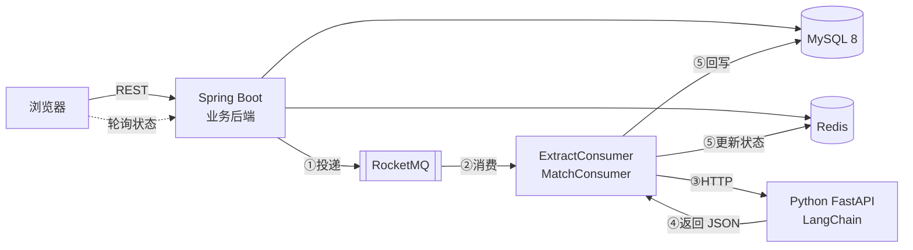
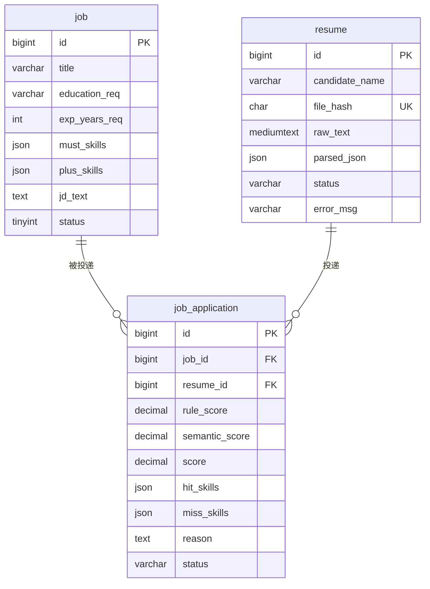
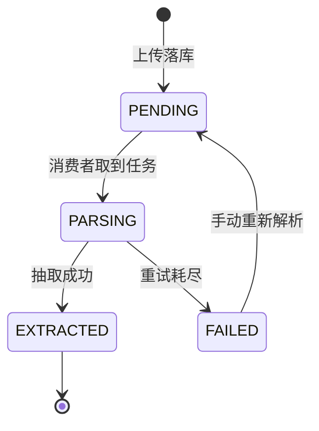
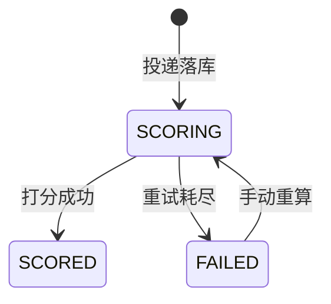
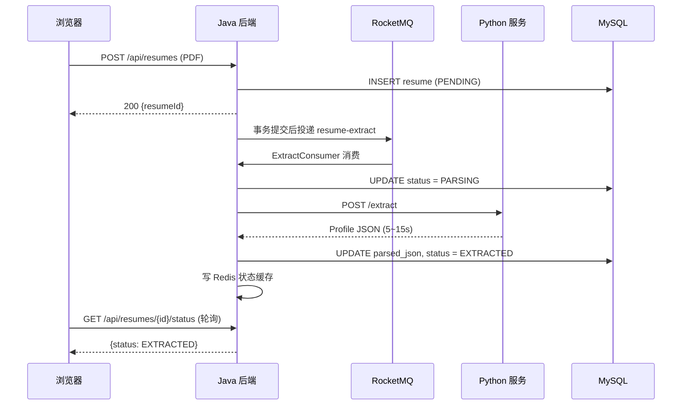

# 简历智能筛选与岗位匹配系统
## 需求规格说明书

| 项目 | 内容 |
|---|---|
| 文档版本 | v1.0 |
| 编写日期 | 2026-10-24 |
| 对应代码版本 | 待建（v0.1 里程碑见 §12） |
| 文档状态 | 已定稿，进入开发 |

**修订记录**

| 版本 | 日期 | 修订内容 |
|---|---|---|
| v1.0 | 2026-10-24 | 首版。确定三表模型、双链路异步架构、规则分与语义分分离的评分方案 |

---

## 1. 项目概述

### 1.1 背景

HR 筛选简历的实际流程是：打开邮箱或招聘后台 → 逐份下载 PDF → 肉眼对照 JD 找关键词 → 判断学历年限是否达标 → 决定约不约面。一个岗位收到 100 份简历，初筛要花 3～4 小时，且标准在人与人之间、同一个人不同时段之间都不一致。

本系统把这个过程自动化：**简历上传即解析，投递即打分，候选人按匹配度自动排序并给出可解释的推荐理由。**

### 1.2 目标

三条可验收的目标，其余都是衍生的：

1. **上传一份 PDF 简历，15 秒内得到结构化档案**——姓名、学历、工作年限、技能列表全部落成可查询的字段，不再是一坨文本。
2. **简历与岗位的匹配分可解释**——每个分数能拆成"学历分 + 年限分 + 技能分 + 语义分"，并明确列出命中了哪些必备技能、缺了哪些。
3. **100 份简历批量导入不阻塞、不丢失**——上传接口始终秒回，后台队列慢慢消化，中途宕机可恢复。

### 1.3 范围

**做（In Scope）**

- 岗位的增删改查，含必备技能、加分技能、学历与年限要求
- PDF 简历上传、文本解析、LLM 结构化抽取
- 简历与岗位的匹配打分、理由生成
- 候选人看板（按分排序、筛选、查看详情）
- 上传与解析的异步链路、状态回传、失败可见

**不做（Out of Scope）**——详见 §14，此处只列最容易失控的四条

- 不做面试安排、offer 流程、入职管理（那是 ATS，不是本系统）
- 不做多租户、多角色权限体系（只有一个角色：HR）
- 不做 Word/图片简历 OCR（只接文本型 PDF，扫描件直接判失败并提示）
- 不做实时推送（SSE/WebSocket），前端轮询足够

### 1.4 术语

| 术语 | 含义 |
|---|---|
| JD | Job Description，岗位描述原文 |
| Profile | 从简历中抽取出的结构化档案（`resume.parsed_json`） |
| 规则分 | 由学历、年限、技能覆盖率按公式算出的确定性分数，Java 侧计算 |
| 语义分 | LLM 综合判断简历与岗位契合度给出的 0–100 分，Python 侧产出 |
| 综合分 | 规则分 × 0.6 + 语义分 × 0.4 |

---

## 2. 角色与用例

### 2.1 角色

系统只有一个角色：**HR**。

> **设计说明**：刻意不做候选人端、不做管理员端。多角色意味着鉴权、数据隔离、菜单权限三套东西，对本项目的评分帮助为零，耗时却翻倍。所有接口用一个简单的 `X-User-Id` 头或固定 token 标识身份即可。

### 2.2 用例清单

| 编号 | 用例 | 优先级 |
|---|---|---|
| UC-01 | 创建/编辑岗位 | P0 |
| UC-02 | 上传简历并自动解析 | P0 |
| UC-03 | 查看解析结果与失败原因 | P0 |
| UC-04 | 投递简历到岗位并自动打分 | P0 |
| UC-05 | 查看候选人看板（按分排序） | P0 |
| UC-06 | 查看匹配详情（分数拆解 + 理由） | P0 |
| UC-07 | 批量上传简历 | P1 |
| UC-08 | 重新触发失败的解析 | P1 |
| UC-09 | 生成面试问题清单 | P2 |

### 2.3 主用例：UC-02 上传简历并自动解析

| 项 | 内容 |
|---|---|
| 触发者 | HR |
| 前置条件 | 无 |
| 后置条件 | 简历状态为 `EXTRACTED`，`parsed_json` 已写入，前端可读到结构化字段 |
| 主流程 | ① HR 选择 PDF 并提交 → ② 系统校验格式与大小，计算文件哈希 → ③ 哈希已存在则直接返回已有记录（去重）→ ④ 落库 `resume`，状态 `PENDING` → ⑤ 事务提交后投递消息 `resume-extract` → ⑥ 消费者调 Python 抽取 → ⑦ 回写 `parsed_json`，状态 `EXTRACTED` → ⑧ 前端轮询到状态变化，展示档案 |
| 异常流程 | A. 文件非 PDF 或超过 10MB → 400，不落库<br>B. PDF 无文本层（扫描件）→ 状态 `FAILED`，`error_msg` = "未检测到文本层，请上传文本型 PDF"<br>C. LLM 调用超时/失败 → 重试 3 次，仍失败则状态 `FAILED`，记录错误<br>D. 重复消费同一消息 → Redis 幂等锁拦截，不重复调用 LLM |
| 业务规则 | 上传接口响应时间不受解析耗时影响，必须 < 500ms |

---

## 3. 总体设计

### 3.1 技术选型

| 层 | 选型 | 说明 |
|---|---|---|
| 前端 | Vue 3 + Vite + Element Plus + Pinia | 4 个页面，不引入路由守卫与动态菜单 |
| 业务后端 | Spring Boot 3.2 + MyBatis-Plus + MySQL 8 | JDK 17 即可，**不需要 JDK 21**，不开虚拟线程 |
| 缓存 | Redis 7（单机） | 只做状态、缓存、幂等锁、排行榜，不做两级缓存 |
| 消息队列 | RocketMQ 5.3 | 两个普通 Topic，无事务消息、无顺序消息 |
| AI 服务 | Python 3.10 + FastAPI + LangChain | 提供 `/extract`、`/match` 两个同步接口 |
| LLM | OpenAI 兼容接口（默认 DeepSeek） | `.env` 配 `LLM_BASE_URL` / `LLM_API_KEY` / `LLM_MODEL` |
| PDF 解析 | pdfplumber | 对中文 PDF 文本层支持好，纯 Python 无需编译 |

> **已刻意移除**：Elasticsearch、Spring Security、Caffeine 二级缓存、SSE、虚拟线程调优、Docker Compose 全栈编排。这些是上一个项目的复杂度来源，与本系统的评分点无关。

### 3.2 架构



**一句话概括**：Java 管业务与状态，Python 管 AI，MQ 把两者之间那条 5～15 秒的耗时操作从用户请求里摘出去。

### 3.3 三条关键设计决策

**D1 — MQ 为什么不能省掉**

简历抽取一次要调 LLM，实测 5～15 秒。如果上传接口同步等，浏览器会超时、用户会重复点击、HTTP 连接被长时间占用。所以必须异步。

那为什么不用线程池直接跑？因为线程池的队列在内存里，服务一重启任务就没了，而用户看到的状态永远卡在 `PENDING`。MQ 提供的是**持久化的任务队列**——这正是它相对于 `@Async` 的唯一不可替代价值。答辩时这一句话就够了。

**D2 — 规则分放 Java，语义分放 AI**

匹配分拆成两半，不是随手加权：

- **学历、年限、必备技能覆盖率** → 确定性规则，Java 侧算。同样的输入永远得到同样的分，可复现、可解释、零成本。
- **"这个人整体上像不像这个岗位要的人"** → 语义判断，LLM 给分。这部分规则写不出来。

把业务规则塞进 prompt 是最常见的错误做法：模型会把"本科"和"硕士"判成差不多，还每次结果都不一样，没法跟 HR 解释。**规则归代码，语义归模型。**

**D3 — Redis 只做加速，MySQL 是唯一真相**

所有状态的权威来源是 MySQL 的 `resume.status` / `job_application.status`。Redis 存的是刷新更快的副本和派生数据（排行榜、幂等锁）。Redis 清空后系统功能完整，只是变慢——这条必须守住，否则会出现"Redis 挂了业务就废了"的架构缺陷。

---

## 4. 功能需求

优先级：P0 必须交付，P1 有余力再做，P2 属于加分项。

### 4.1 岗位管理（FR-JOB）

| 编号 | 需求 | 优先级 |
|---|---|---|
| FR-JOB-01 | 创建岗位：岗位名称、部门、学历要求、年限要求、必备技能列表、加分技能列表、JD 原文 | P0 |
| FR-JOB-02 | 岗位列表分页查询，支持按状态筛选（开放/关闭） | P0 |
| FR-JOB-03 | 编辑与关闭岗位；已关闭岗位不接受新投递 | P0 |
| FR-JOB-04 | 必备技能与加分技能以字符串数组存储，录入时自动 trim 并去重 | P0 |
| FR-JOB-05 | 岗位详情展示当前投递人数与平均分 | P1 |

**字段约束**：必备技能至少 1 项，最多 20 项；学历要求取值 `不限/大专/本科/硕士/博士`；年限要求 0～30 的整数。

### 4.2 简历上传与解析（FR-RES）

| 编号 | 需求 | 优先级 |
|---|---|---|
| FR-RES-01 | 接受 `multipart/form-data` 上传，仅允许 `application/pdf`，单文件 ≤ 10MB | P0 |
| FR-RES-02 | 以文件内容 SHA-256 去重，同一份简历重复上传返回已有记录，不重复解析 | P0 |
| FR-RES-03 | 上传接口同步返回 `resumeId` 与初始状态，**不得等待解析完成** | P0 |
| FR-RES-04 | 提供状态轮询接口，返回 `status` 与错误信息 | P0 |
| FR-RES-05 | 简历列表支持按状态筛选、按上传时间倒序 | P0 |
| FR-RES-06 | 批量上传：一次最多 20 份，逐份独立处理，单份失败不影响其他 | P1 |
| FR-RES-07 | 对 `FAILED` 简历提供"重新解析"操作，重置状态并重新投递 | P1 |

**状态取值**：`PENDING`（已入库待处理）、`PARSING`（Python 处理中）、`EXTRACTED`（成功）、`FAILED`（失败）。

### 4.3 智能抽取（FR-AI）

| 编号 | 需求 | 优先级 |
|---|---|---|
| FR-AI-01 | 从 PDF 中提取文本层；若无文本层，判定失败并给出明确提示 | P0 |
| FR-AI-02 | 调用 LLM 抽取结构化 Profile，字段见 §9.2，缺字段返回 `null` 而非编造 | P0 |
| FR-AI-03 | 技能名称归一化：`SpringBoot`→`Spring Boot`、`mysql`→`MySQL`，依据别名映射表 | P0 |
| FR-AI-04 | 抽取结果连同原始文本一并落库，原始文本供后续重新抽取使用 | P0 |
| FR-AI-05 | 每次抽取记录耗时与 token 消耗，写入日志供评估 | P1 |

### 4.4 匹配打分（FR-MAT）

| 编号 | 需求 | 优先级 |
|---|---|---|
| FR-MAT-01 | 投递时校验简历状态必须为 `EXTRACTED`，否则返回 409 并提示先解析 | P0 |
| FR-MAT-02 | 规则分按 §9.3 公式计算，命中与缺失技能采用集合运算，结果可复现 | P0 |
| FR-MAT-03 | 语义分由 LLM 给出 0–100 整数，并生成不超过 120 字的推荐理由 | P0 |
| FR-MAT-04 | 综合分 = 规则分 × 0.6 + 语义分 × 0.4，保留两位小数 | P0 |
| FR-MAT-05 | 同一简历对同一岗位重复投递视为更新，覆盖原分数，不新增记录 | P0 |
| FR-MAT-06 | 打分失败时状态置 `FAILED`，不影响简历本身可用 | P0 |

### 4.5 候选人看板（FR-BOARD）

| 编号 | 需求 | 优先级 |
|---|---|---|
| FR-BOARD-01 | 按岗位查看候选人列表，默认按综合分倒序 | P0 |
| FR-BOARD-02 | 展示：姓名、学历、年限、综合分、命中技能数、状态 | P0 |
| FR-BOARD-03 | 支持按最低分、学历要求过滤 | P1 |
| FR-BOARD-04 | 详情页展示分数拆解（四个分项 + 权重）、命中/缺失技能标签、推荐理由、完整 Profile | P0 |

---

## 5. 数据模型

### 5.1 ER



### 5.2 DDL

```sql
CREATE TABLE `job` (
  `id`             BIGINT       NOT NULL AUTO_INCREMENT,
  `title`          VARCHAR(100) NOT NULL COMMENT '岗位名称',
  `department`     VARCHAR(100)          DEFAULT NULL,
  `education_req`  VARCHAR(10)  NOT NULL DEFAULT '不限' COMMENT '不限/大专/本科/硕士/博士',
  `exp_years_req`  INT          NOT NULL DEFAULT 0,
  `must_skills`    JSON         NOT NULL COMMENT '必备技能，字符串数组',
  `plus_skills`    JSON                  DEFAULT NULL COMMENT '加分技能',
  `jd_text`        TEXT                  DEFAULT NULL COMMENT 'JD 原文',
  `status`         TINYINT      NOT NULL DEFAULT 1 COMMENT '1 开放 0 关闭',
  `created_at`     DATETIME     NOT NULL DEFAULT CURRENT_TIMESTAMP,
  `updated_at`     DATETIME     NOT NULL DEFAULT CURRENT_TIMESTAMP ON UPDATE CURRENT_TIMESTAMP,
  PRIMARY KEY (`id`),
  KEY `idx_status` (`status`)
) ENGINE=InnoDB DEFAULT CHARSET=utf8mb4 COMMENT='岗位';

CREATE TABLE `resume` (
  `id`             BIGINT       NOT NULL AUTO_INCREMENT,
  `candidate_name` VARCHAR(50)           DEFAULT NULL COMMENT '抽取得到，解析前为空',
  `phone`          VARCHAR(20)           DEFAULT NULL,
  `email`          VARCHAR(100)          DEFAULT NULL,
  `file_name`      VARCHAR(255) NOT NULL COMMENT '原始文件名',
  `file_path`      VARCHAR(500) NOT NULL COMMENT '相对 uploads 根的路径',
  `file_hash`      CHAR(64)     NOT NULL COMMENT '文件内容 SHA-256，去重',
  `raw_text`       MEDIUMTEXT            DEFAULT NULL COMMENT 'PDF 文本层原文',
  `parsed_json`    JSON                  DEFAULT NULL COMMENT 'LLM 抽取的结构化 Profile',
  `status`         VARCHAR(20)  NOT NULL DEFAULT 'PENDING'
                   COMMENT 'PENDING/PARSING/EXTRACTED/FAILED',
  `error_msg`      VARCHAR(500)          DEFAULT NULL,
  `cost_ms`        INT                   DEFAULT NULL COMMENT '解析耗时',
  `created_at`     DATETIME     NOT NULL DEFAULT CURRENT_TIMESTAMP,
  `updated_at`     DATETIME     NOT NULL DEFAULT CURRENT_TIMESTAMP ON UPDATE CURRENT_TIMESTAMP,
  PRIMARY KEY (`id`),
  UNIQUE KEY `uk_file_hash` (`file_hash`),
  KEY `idx_status` (`status`),
  KEY `idx_created` (`created_at`)
) ENGINE=InnoDB DEFAULT CHARSET=utf8mb4 COMMENT='简历';

CREATE TABLE `job_application` (
  `id`              BIGINT       NOT NULL AUTO_INCREMENT,
  `job_id`          BIGINT       NOT NULL,
  `resume_id`       BIGINT       NOT NULL,
  `rule_score`      DECIMAL(5,2)          DEFAULT NULL COMMENT '0-100 确定性分数',
  `semantic_score`  DECIMAL(5,2)          DEFAULT NULL COMMENT '0-100 LLM 分数',
  `score`           DECIMAL(5,2)          DEFAULT NULL COMMENT '综合分',
  `hit_skills`      JSON                  DEFAULT NULL,
  `miss_skills`     JSON                  DEFAULT NULL,
  `reason`          VARCHAR(500)          DEFAULT NULL COMMENT '推荐理由',
  `status`          VARCHAR(20)  NOT NULL DEFAULT 'SCORING'
                    COMMENT 'SCORING/SCORED/FAILED',
  `error_msg`       VARCHAR(500)          DEFAULT NULL,
  `created_at`      DATETIME     NOT NULL DEFAULT CURRENT_TIMESTAMP,
  `updated_at`      DATETIME     NOT NULL DEFAULT CURRENT_TIMESTAMP ON UPDATE CURRENT_TIMESTAMP,
  PRIMARY KEY (`id`),
  UNIQUE KEY `uk_job_resume` (`job_id`, `resume_id`),
  KEY `idx_job_score` (`job_id`, `score` DESC)
) ENGINE=InnoDB DEFAULT CHARSET=utf8mb4 COMMENT='投递记录';
```

> `uk_job_resume` 让 FR-MAT-05 的"重复投递即更新"由数据库保证，不用在代码里查一遍再判断。

---

## 6. 接口设计

### 6.1 统一响应

```json
{ "code": 0, "message": "ok", "data": {} }
```

`code` 为 0 表示成功。业务错误用非 0 码，HTTP 状态码同步设置。

### 6.2 接口清单

| 方法 | 路径 | 说明 | 优先级 |
|---|---|---|---|
| POST | `/api/jobs` | 创建岗位 | P0 |
| GET | `/api/jobs` | 岗位分页列表 | P0 |
| GET | `/api/jobs/{id}` | 岗位详情 | P0 |
| PUT | `/api/jobs/{id}` | 编辑岗位 | P0 |
| PUT | `/api/jobs/{id}/status` | 开放/关闭 | P0 |
| POST | `/api/resumes` | 上传简历（multipart） | P0 |
| POST | `/api/resumes/batch` | 批量上传 | P1 |
| GET | `/api/resumes/{id}` | 简历详情（含 Profile） | P0 |
| GET | `/api/resumes/{id}/status` | **轮询解析状态** | P0 |
| POST | `/api/resumes/{id}/retry` | 重新解析 | P1 |
| POST | `/api/applications` | 投递并触发打分 | P0 |
| GET | `/api/applications/{id}` | 匹配详情（分数拆解） | P0 |
| GET | `/api/jobs/{id}/applications` | 候选人看板 | P0 |

Python 服务（内网调用，不对外暴露）：

| 方法 | 路径 | 说明 |
|---|---|---|
| POST | `/extract` | PDF → Profile |
| POST | `/match` | Profile + Job → 语义分与理由 |
| GET | `/health` | 健康检查 |

### 6.3 关键接口详述

**POST /api/resumes**

请求：`multipart/form-data`，字段名 `file`

响应：

```json
{ "code": 0, "data": { "resumeId": 1001, "status": "PENDING", "duplicated": false } }
```

`duplicated` 为 `true` 时表示命中去重，直接返回库里已有记录的 `resumeId` 与当前状态，前端应跳转到该简历详情而非等待解析。

**GET /api/resumes/{id}/status**

```json
{ "code": 0, "data": { "status": "PARSING", "errorMsg": null, "candidateName": null } }
```

> 前端轮询策略：上传后立即轮询，间隔 1s，连续 3 次无变化后改为 3s，总时长超过 30s 停止并提示用户稍后刷新。不做 WebSocket 推送。

**POST /api/applications**

```json
{ "jobId": 12, "resumeId": 1001 }
```

响应 `{ "code": 0, "data": { "applicationId": 5001, "status": "SCORING" } }`。
若简历未解析完成，返回 `409` + `code=1003`。

**GET /api/applications/{id}**

```json
{
  "code": 0,
  "data": {
    "applicationId": 5001,
    "jobTitle": "Java 后端开发",
    "candidateName": "张某某",
    "status": "SCORED",
    "score": 78.40,
    "breakdown": {
      "educationScore": 40,
      "expScore": 15,
      "skillScore": 24,
      "ruleScore": 79,
      "semanticScore": 77.5,
      "weights": { "rule": 0.6, "semantic": 0.4 }
    },
    "hitSkills": ["Java", "Spring Boot", "MySQL"],
    "missSkills": ["RocketMQ"],
    "reason": "后端基础扎实，Spring 生态使用熟练，但缺少消息队列的实战经历……",
    "profile": { }
  }
}
```

### 6.4 错误码

| code | HTTP | 含义 |
|---|---|---|
| 1001 | 400 | 文件格式不支持 / 超过大小限制 |
| 1002 | 404 | 简历或岗位不存在 |
| 1003 | 409 | 简历尚未解析完成，无法投递 |
| 1004 | 409 | 岗位已关闭 |
| 1005 | 400 | 必备技能为空 |
| 1006 | 429 | 上传过于频繁（限流） |
| 2001 | 500 | PDF 未检测到文本层 |
| 2002 | 500 | LLM 调用失败 |
| 2003 | 500 | 抽取结果不符合 Schema |

---

## 7. 异步链路

### 7.1 Topic 设计

| Topic | 生产者 | 消费者 | 消费组 | 用途 |
|---|---|---|---|---|
| `resume-extract` | Java（上传接口） | `ExtractConsumer` | `resume-extract-consumer-group` | 触发简历解析 |
| `match-score` | Java（投递接口） | `MatchConsumer` | `match-score-consumer-group` | 触发匹配打分 |

两个 Topic 结构对称，每个都只有一条 `*` 标签，不分子 tag —— 只有一个消费场景时再拆 tag 属于过度设计。

### 7.2 消息体

字段名统一 **camelCase**（Java 侧序列化约定）。

`resume-extract`：

```json
{
  "messageId": "3f2a9c1e-...",
  "resumeId": 1001,
  "filePath": "uploads/2026/10/24/3f2a9c1e.pdf",
  "attempt": 1,
  "timestamp": 1761312000000
}
```

`match-score`：

```json
{
  "messageId": "8b1d7e4a-...",
  "applicationId": 5001,
  "resumeId": 1001,
  "jobId": 12,
  "timestamp": 1761312000000
}
```

> `attempt` 由生产者在重投时递增，消费者据此判断是否已是最后一次尝试。`messageId` 用于幂等，也是全链路日志的关联键。

### 7.3 消费与重试策略

| 项 | 策略 |
|---|---|
| 投递时机 | **事务提交后**投递（`TransactionSynchronizationManager#afterCommit`），不在事务内投递，避免"消息发出去了但库里回滚了" |
| 消费并发 | 每个消费组 2 个线程，单次拉取 1 条 |
| 重试 | 消费抛异常时 `RECONSUME_LATER`，最多 3 次 |
| 耗尽后 | 状态置 `FAILED`，`error_msg` 记录最后一次异常摘要，**不静默丢弃** |
| 幂等 | 消费入口先 `SETNX resume:lock:{resumeId}`，拿到锁才处理；处理结束释放 |
| 顺序 | 不要求顺序。同一简历若被重复投递，幂等锁 + 状态判断（已 `EXTRACTED` 则跳过）兜住 |

### 7.4 状态机

简历：



投递记录：



### 7.5 时序



---

## 8. Redis 设计

键名统一 `业务:对象:标识` 冒号分隔，全部设置 TTL，禁止无过期时间的键堆积。

| 键 | 类型 | TTL | 用途 | 缺失时行为 |
|---|---|---|---|---|
| `resume:status:{resumeId}` | Hash | 24h | 缓存 status/errorMsg，轮询直接读 | 回查 MySQL 并回填 |
| `resume:lock:{resumeId}` | String (SETNX) | 120s | 消费幂等锁 | 可正常处理 |
| `resume:profile:{resumeId}` | String (JSON) | 1h | 抽取结果缓存 | 回查 MySQL |
| `board:{jobId}` | ZSet | 10min | 候选人排行榜，score 为综合分 | 从 MySQL 重建 |
| `ratelimit:upload:{userId}` | String (INCR) | 60s | 上传限流，20 次/分钟 | 从 0 开始计数 |

**三条使用原则**

1. **不做缓存穿透专项治理**（布隆过滤器、空值缓存）——本系统数据量小，命中率本身就高，加这些属于表演。
2. **不做 Caffeine + Redis 两级缓存**——单机部署，一级缓存省下的那点 RTT 抵不过它带来的不一致问题。
3. **排行榜只做加速**：`board:{jobId}` 里的 ZSet 是靠 MySQL 数据构建的视图，前端看到的列表接口仍以 MySQL 分页查询为准。ZSet 只用于"前 20 名快速拉取"这一条路径。

---

## 9. AI 服务设计

### 9.1 职责边界

Python 服务只做两件事，**不碰数据库、不碰业务规则、不碰状态**：

- `POST /extract`：PDF 文件 → 结构化 Profile
- `POST /match`：Profile + Job → 语义分 + 理由 + 命中/缺失技能说明

所有落库、状态流转、分数加权都在 Java 侧完成。这样 Python 服务可以独立重启、独立替换模型，不影响业务。

### 9.2 抽取 Schema

```python
from pydantic import BaseModel, Field
from typing import Literal, Optional

class Education(BaseModel):
    degree: Literal["大专", "本科", "硕士", "博士", "其他"]
    school: Optional[str] = None
    major: Optional[str] = None
    grad_year: Optional[int] = None

class Experience(BaseModel):
    company: str
    title: str
    period: Optional[str] = None        # 如 "2022.07-2024.03"
    summary: str = Field(max_length=120)

class ResumeProfile(BaseModel):
    name: Optional[str] = None
    phone: Optional[str] = None
    email: Optional[str] = None
    education: Optional[Education] = None
    total_years: Optional[float] = None   # 工作年限，不含实习
    skills: list[str] = Field(default_factory=list)
    experiences: list[Experience] = Field(default_factory=list)
    summary: str = Field(max_length=200)  # 一句话人物画像
```

**Prompt 的三条硬约束**（写进 system message，必须逐条验证）：

1. 简历中未出现的信息一律返回 `null`，**禁止推测**。学历没写就返回 `null`，不要因为"看起来像应届"就填"本科"。
2. `total_years` 只统计正式工作经历，实习、兼职、校内项目不计入。
3. `skills` 只收录明确出现的技术名词，输出标准写法（见 §6 的归一化映射表），不输出"编程能力强"这类描述。

用 LangChain 的 `with_structured_output(ResumeProfile)` 拿到对象，比让模型自由输出 JSON 再解析稳定得多。

### 9.3 打分算法

**规则分（Java 计算，满分 100）**

| 分项 | 满分 | 计算 |
|---|---|---|
| 学历分 | 40 | 满足要求 = 40；低一档 = 15；低两档及以上 = 0；要求"不限" = 40 |
| 年限分 | 30 | ≥ 要求 = 30；差 1 年 = 15；差 ≥ 2 年 = 0 |
| 技能分 | 30 | ⌈命中必备技能数 ÷ 必备技能总数⌉ × 30，四舍五入 |

学历档位序：`大专 < 本科 < 硕士 < 博士`。

**语义分（Python，0–100）**

把 `job.jd_text` 与 `profile.summary + skills + experiences` 一起交给 LLM，要求给出整数分与理由。提示词强调：

> 只评估"经历与岗位要求的契合程度"，学历和年限达标与否已由规则计算，不要重复扣分。

**综合分**

```
score = rule_score * 0.6 + semantic_score * 0.4
```

权重 0.6/0.4 的理由：规则分是硬指标，权重该高；但规则分测不出"做过电商后台"和"做过招聘系统"在同一个 Java 岗位下的差异，这部分交给语义分兜。

### 9.4 失败降级

| 情况 | 处理 |
|---|---|
| LLM 超时（> 60s） | 抛异常 → 消费重试。Python 侧不自行重试，避免放大延迟 |
| LLM 返回不合 Schema | 用 Pydantic 校验，失败时抛 `2003`；重试 1 次仍失败则整体 `FAILED` |
| 语义分调用失败但抽取成功 | 简历仍为 `EXTRACTED`，投递记录置 `FAILED`，可单独重算打分 |
| 无文本层 PDF | 直接 `FAILED`，不调 LLM，省一次调用成本 |

---

## 10. 非功能需求

| 类别 | 要求 |
|---|---|
| 性能 | 上传接口 P95 < 500ms；单份简历抽取 P95 < 15s；看板列表 P95 < 300ms（50 条） |
| 并发 | 支持 5 个并发上传与解析，队列积压时按序处理不丢消息 |
| 容量 | 单岗位 500 份简历、单库 5000 份简历下功能正常 |
| 可用性 | Python 服务重启期间，上传接口仍可用（任务在 MQ 中等待，恢复后自动消费） |
| 安全 | 上传文件类型与大小双重校验；文件存储路径由服务端生成，不使用用户文件名拼接路径；LLM 请求前对简历做长度截断（超 8000 字符截断），避免超长输入 |
| 可观测 | 记录三类日志：上传（含 fileHash）、消费（含 messageId、attempt）、LLM 调用（含耗时与 token）；关键异常打 `ERROR` 并带 `resumeId` |
| 可维护 | 跨语言字段约定集中在 `docs/message-contract.md`，改字段先改文档 |

---

## 11. 验收标准

### 11.1 功能验收清单

| # | 验收项 | 通过标准 |
|---|---|---|
| 1 | 上传 PDF | 返回 200 与 resumeId，耗时 < 500ms |
| 2 | 重复上传同一文件 | `duplicated=true`，不新增记录，不重复调用 LLM |
| 3 | 解析完成 | 15s 内状态变 `EXTRACTED`，`parsed_json` 含 name/education/skills/total_years |
| 4 | 上传图片型 PDF | 状态 `FAILED`，提示"未检测到文本层" |
| 5 | 未解析完成就投递 | 返回 409 / code 1003 |
| 6 | 打分结果 | 详情页四个分项相加与综合分吻合，命中/缺失技能与岗位必备技能对得上 |
| 7 | 重复投递 | 不新增记录，分数被覆盖更新 |
| 8 | 看板排序 | 按综合分倒序，与数据库 `ORDER BY score DESC` 一致 |
| 9 | Python 服务停机后上传 | 接口正常返回，状态停在 `PENDING`/`PARSING`；恢复后自动完成 |
| 10 | Redis 清空 | 功能全部正常，仅第一次轮询变慢 |

### 11.2 演示脚本（3 分钟）

1. 建岗位「Java 后端开发」：必备 `Java / Spring Boot / MySQL / RocketMQ`，本科，3 年。
2. 上传 3 份简历：①完全匹配 ②技能匹配但年限差 2 年 ③技能完全不匹配的前端简历。
3. 现场展示状态从 `PENDING` 跳到 `EXTRACTED`，点开看抽取出的结构化字段。
4. 全部投递，看板按分排序，匹配的那份排第一。
5. 点开第二名，展示分数拆解：学历分满、年限分 15，并显示缺失技能标签。
6. **压轴**：停掉 Python 服务，再上传一份简历，展示状态停在 `PARSING`；重新启动 Python，等几秒，状态自动变成 `EXTRACTED`。

> 第 6 步是全场最有说服力的一步，它证明 MQ 是真的在用，不是装饰。

### 11.3 效果评估

抽取准确率不靠感觉，按下面方式量化：

- 手工标注 10 份测试简历的关键字段（学历、年限、技能数）作为真值，与系统输出逐字段比对，记录准确率。
- 语义分合理性：准备 5 组"明显该高分 / 明显该低分"的配对，检查排序是否与人工判断一致。
- 抽 5 份简历重复解析两次，检查 `skills` 是否稳定（抖动大说明 prompt 需要收紧）。

---

## 12. 里程碑

| 天数 | 内容 | 产出 |
|---|---|---|
| D1 | 建库建表、Spring Boot 骨架、岗位 CRUD | 岗位接口可用 |
| D2 | 上传接口、文件存储、哈希去重、Redis 状态 | 上传 200 返回 |
| D3 | RocketMQ 接入、ExtractConsumer 骨架、状态机流转 | 消息能发能收，状态能变 |
| D4 | Python 服务：PDF 解析 + 抽取链路 + Schema 校验 | `/extract` 可用 |
| D5 | 匹配链路：规则分 + 语义分 + 理由 + `/match` | 全链路打通 |
| D6 | 前端：岗位列表 + 上传页 + 轮询 | 能看能传 |
| D7 | 前端：候选人看板 + 匹配详情 | 主流程完整 |
| D8 | 联调、造 20 份演示数据、验收清单逐条过、写文档 | 可演示 |

**关键路径是 D3→D5**。D1-D2 是纯 CRUD，不会卡；D3 的 MQ 环境和 D4 的 LLM 连通性是最可能卡住的两个点，建议 D1 就把 RocketMQ 和 LLM 的连通性各跑一个 hello world 验证掉。

---

## 13. 风险与对策

| 风险 | 概率 | 影响 | 对策 |
|---|---|---|---|
| RocketMQ 本地起不来（内存/配置） | 中 | 阻塞 D3 | 启动脚本加 `-Xms512m -Xmx512m`；broker 配置 `autoCreateTopicEnable=true` |
| LLM 接口不稳定或额度不足 | 中 | 阻塞 D4/D5 | 抽象 `LLMClient`，支持切换本地 Ollama；准备一套 mock 响应供前端联调 |
| 中文 PDF 抽取乱码 | 中 | 影响抽取质量 | 用 pdfplumber 而非 PyPDF2；对乱码文本直接判失败，不硬喂给模型 |
| 抽取字段不准（模型编造） | 高 | 影响可信度 | Prompt 硬约束 + Pydantic 校验 + 归一化映射表；用 10 份标注集量化 |
| 工作量超预期 | 中 | 延期 | P1/P2 全部可砍，P0 是最小可交付；砍的顺序：面试问题 → 批量上传 → 看板筛选 |
| 分数分布不合理（都挤在 70 分） | 中 | 演示效果差 | 规则分权重先落地调准；准备三份差异明显的演示简历，不依赖模型给极端分 |

---

## 14. 明确不做的事

写在这里是为了防止开发过程中临时加需求把自己拖死。**以下任何一条都不讨论。**

| 不做 | 理由 |
|---|---|
| Elasticsearch / 向量库 | 二三十份简历，MySQL 全表扫都比它快。上向量库是为了简历好看，不是为了解决问题 |
| Spring Security 完整权限体系 | 单角色系统，一个拦截器校验固定 token 足够 |
| Caffeine + Redis 两级缓存 | 见 §8 原则 2 |
| SSE / WebSocket 实时推送 | 轮询 1 次/秒完全够用，省下一整套连接管理代码 |
| 虚拟线程 / 线程池调优 | 默认配置能跑，调优没有场景支撑，讲不出所以然 |
| Docker Compose 全栈编排 | 本地四个进程手动起，比调镜像快得多。演示前一晚再考虑容器化 |
| 多租户 / 数据行级隔离 | 无此需求 |
| 简历 Word/图片 OCR | 只接文本型 PDF |
| 面试安排、offer 审批流 | ATS 范畴，与"智能筛选"无关 |
| 自研模型微调 | 用现成 LLM + 结构化输出，效果够用且可控 |

---

## 附录 A：技能归一化映射（示例）

放在 `ai-service/resources/skill_alias.json`，命中即替换为标准写法：

```json
{
  "springboot": "Spring Boot",
  "spring boot": "Spring Boot",
  "springcloud": "Spring Cloud",
  "mysql": "MySQL",
  "redis": "Redis",
  "rocketmq": "RocketMQ",
  "mq": "RocketMQ",
  "vue": "Vue",
  "vue3": "Vue",
  "js": "JavaScript",
  "javascript": "JavaScript",
  "py": "Python",
  "python3": "Python"
}
```

匹配时统一转小写查询，输出标准写法。这张表决定了"技能命中率"这一项的准确度，值得在演示数据上反复校准。

## 附录 B：跨语言字段约定

| 通道 | 命名风格 | 原因 |
|---|---|---|
| RocketMQ 消息体 | camelCase | Java 侧 `ObjectMapper` 默认输出 |
| Java → Python HTTP 请求 | snake_case | 与 Python Pydantic 模型字段一致 |
| Python → Java HTTP 响应 | camelCase | 与 Java DTO 对齐 |

这条不一致是刻意的：两种语言各用自己最自然的风格，转换发生在 HTTP 边界。**但必须写进 `docs/message-contract.md`，否则跨端字段名对不上会排查很久。**
